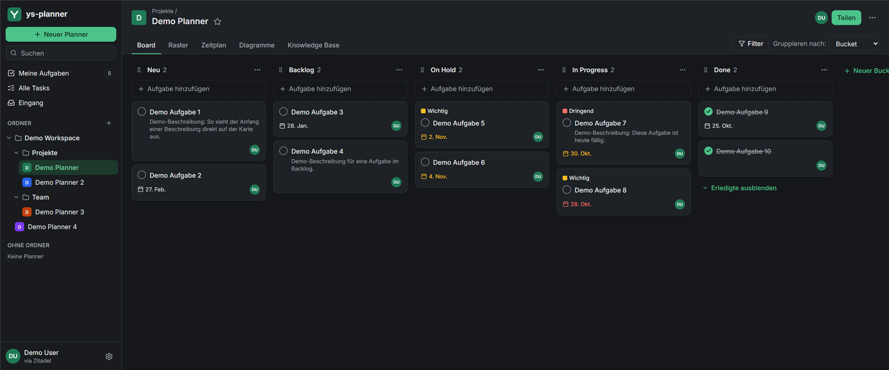

# ys-planner

**A planner for teams and solo projects: boards, timelines, a knowledge base and an MCP server, running on Cloudflare Workers.**

[Live app](https://planner.salm.li) · [Setup and technical docs](docs/SETUP.md)



<sub>Screenshot with demo data. The interface is in German.</sub>

## Features

| | |
|---|---|
| **Board, grid, timeline, charts** | Four views of the same tasks, with filters and grouping |
| **Nested folders** | Sharing a folder covers everything inside it |
| **Knowledge base** | Markdown files per planner, attachable to tasks |
| **Guest links** | Read or edit access, with optional password and expiry, revocable at any time |
| **Live updates** | Changes and presence appear instantly through Supabase Realtime |
| **Email to planner** | Forward an email to your personal address and it becomes a task, including attachments |
| **My tasks and all tasks** | Everything assigned to you, or everything you can see, across all planners |
| **Reminders and notifications** | Emails for assignments, mentions, invitations and due dates |
| **MCP server** | Let Claude read and manage tasks, signed in with OAuth 2.1 and limited to your own permissions |

## Tech stack

- **App:** Next.js 16, React 19, TypeScript, Tailwind CSS 4
- **Hosting:** Cloudflare Workers through OpenNext, with Cron Triggers and Email Routing
- **Data:** Supabase (Postgres, Row Level Security, Realtime), Cloudflare R2 for files
- **Login and email:** Zitadel (OIDC with PKCE), Resend

## How access is secured

- **One source of truth:** Every read and write runs with the user's own short-lived JWT, so Postgres RLS decides what is allowed, including for guests and MCP clients.
- **Files follow the same rules:** R2 has no RLS, so each file request goes through a route handler that checks the user's role first.
- **Tested policies:** Nearly 100 RLS test cases cover owners, editors, viewers, folder members, guests, strangers, and revoked or forged links.
- **Immediate revocation:** Guest links are checked on every query, so revoking one takes effect right away.

## Getting started

You need Node.js 22+, a Supabase project and a Zitadel application. The full setup is in [docs/SETUP.md](docs/SETUP.md).

```bash
npm install
cp .env.example .env.local   # fill in your own values
npm run dev                  # http://localhost:3040
```

| Command | Purpose |
|---|---|
| `npm test` | Unit tests (Vitest) |
| `npm run test:rls` | RLS tests against `DATABASE_URL` |
| `npm run typecheck` / `npm run lint` | Static checks |
| `npm run deploy` | Build and deploy to Cloudflare |
